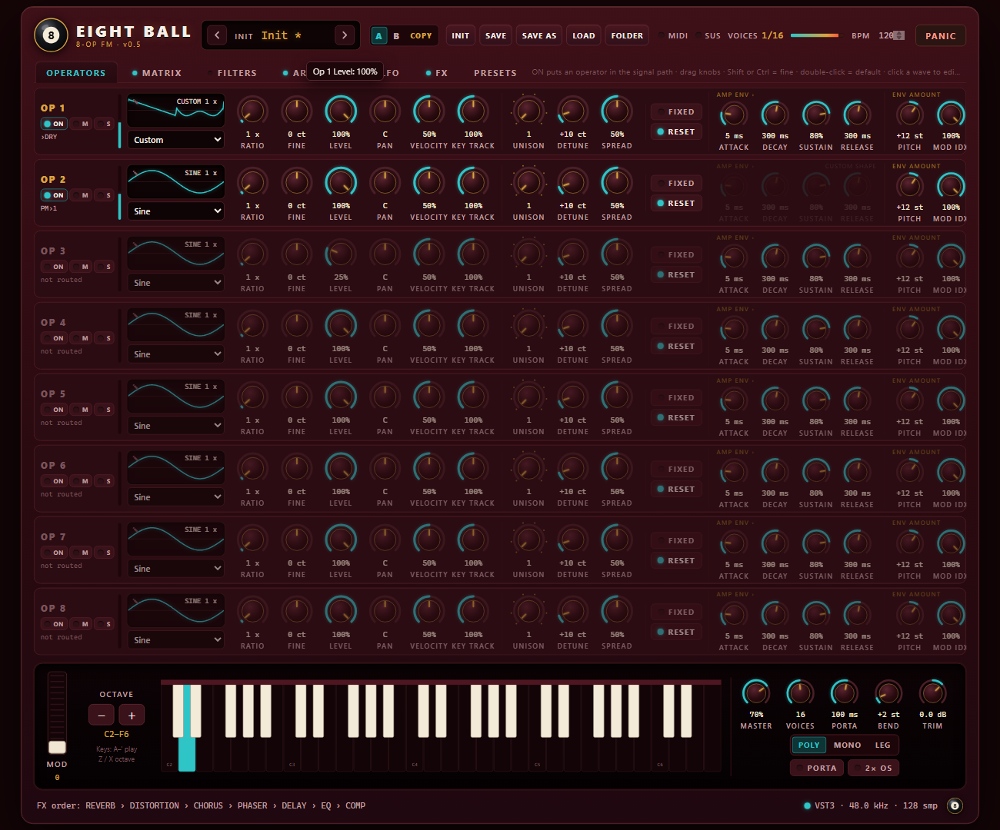
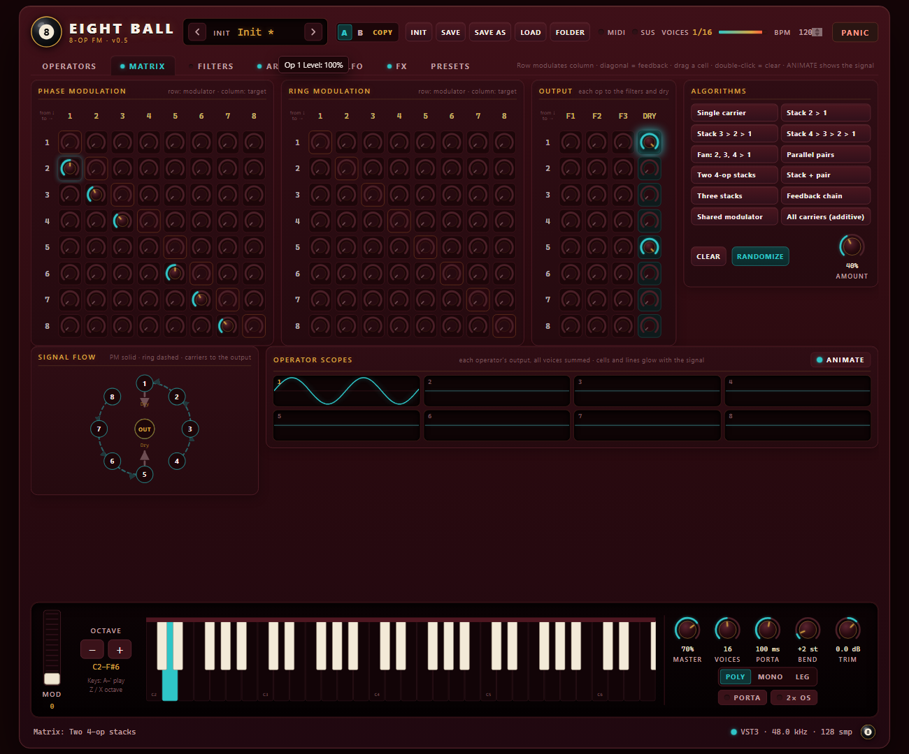
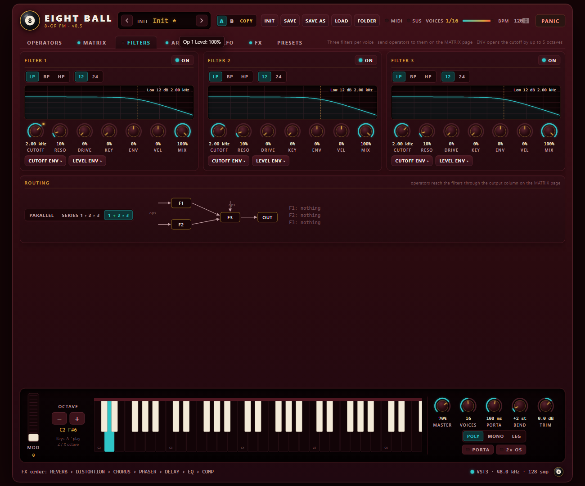
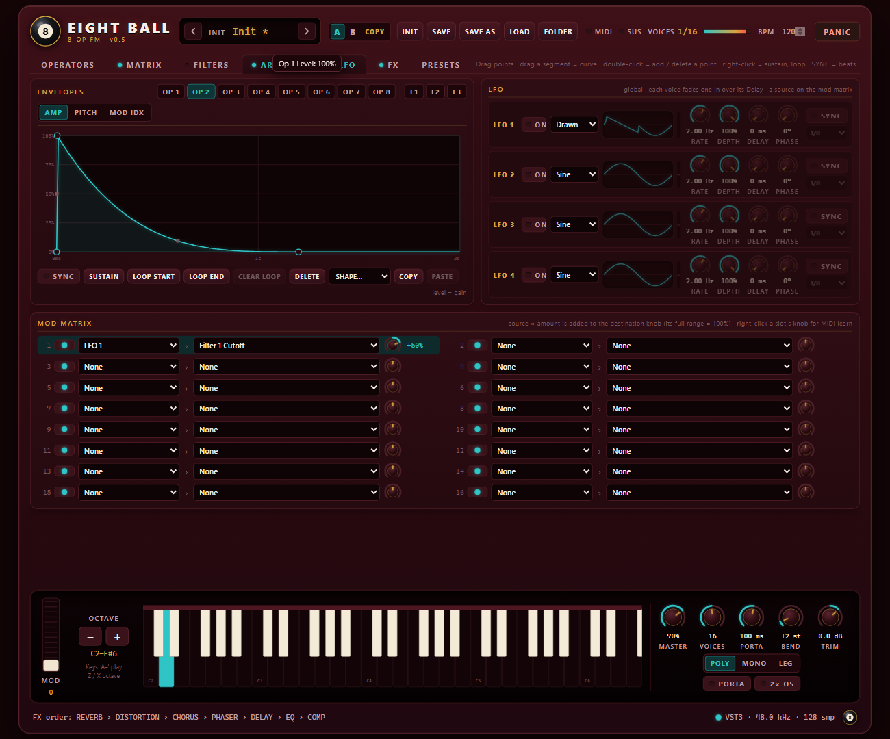
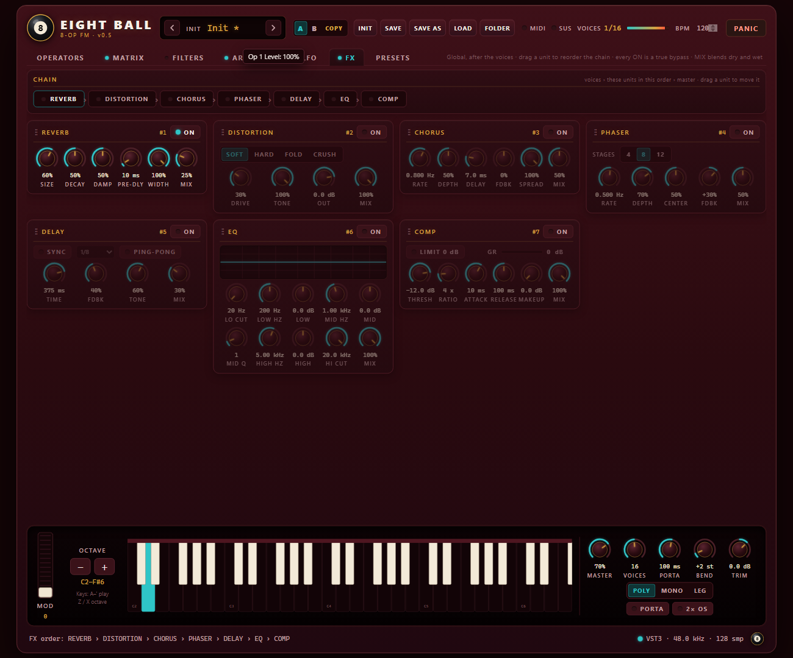
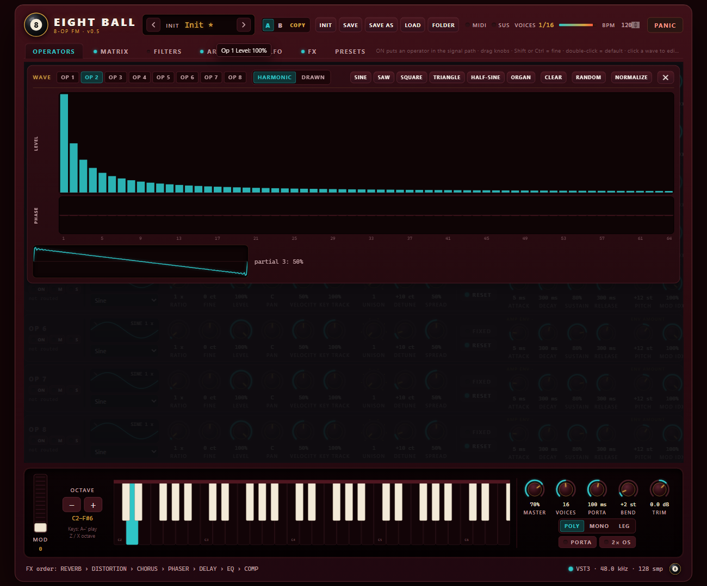

# Eight Ball: v0.5 (milestone 5 of 6)

Eight Ball is an 8-operator FM synthesizer: harmonic-editor wavetable operators, an 8×8 phase-modulation grid
plus an 8×8 ring-modulation grid, three multimode filters, freeform envelopes, four LFOs, a mod matrix, an FX
chain and 64 presets, in a VST3 plugin, a Standalone app and (last) a browser build that runs the same DSP core
as WebAssembly. It is the fifth instrument in the family after
[E-Piano](https://github.com/BlinkZer0/E-PianoVST), Brass Knuckles, No Strings and The Ham, and is built the
same way.

| Build | Where | Status |
|---|---|---|
| **VST3 plugin** + Standalone | [`vst/`](vst/README.md) | milestone 5: the full synth (8 operators with the wave editor, the matrix, filters, envelopes, LFOs, mod matrix, FX chain, animated matrix), 1044 level-matched factory presets built on 8-operator architectures, A/B compare, preset search; all automated checks pass |
| **Web build** | `web/index.html` | milestone 6 |

The plan, the milestones and the measured results are in [docs/PLAN.md](docs/PLAN.md). The house rules are in
[docs/CONVENTIONS.md](docs/CONVENTIONS.md).

## Screenshots

| OPERATORS | MATRIX |
|---|---|
|  |  |

| FILTERS | ARTICULATORS · LFO |
|---|---|
|  |  |

| FX | WAVE EDITOR (on the OPERATORS page) |
|---|---|
|  |  |

(made by `vst\tests\run-ui-tests.ps1` from the real UI with a stand-in bridge)

## What it does so far (milestones 1 to 5)

**The 8 operators**
- Each operator plays a **band-limited, mipmapped wavetable** baked from a set of partials (level and phase each)
  or a drawn cycle, so high notes don't alias. Starter shapes: sine, saw, square, triangle, half-sine, noise.
- **Click an operator's wave screen to open the wave editor**: **HARMONIC** mode shows 64 partials as level bars
  and phase bars (drag across them to paint, double-click a bar to reset it); **DRAWN** mode is a 256-point cycle
  you draw by hand. Switching modes converts the wave either way (a harmonic sum, or a DFT of the drawing).
  Starters (sine, saw, square, triangle, half-sine, organ), CLEAR, RANDOM, NORMALIZE, a live preview of the cycle.
  Editing sets the operator's wave to Custom; the plugin bakes the new table in about 2 ms while you drag.
- **Ratio** 0.5–32 in half steps, **fine** ±100 cents, **fixed** frequency mode (Hz), **key tracking** 0–200%.
- **Level**, **pan**, **velocity** sensitivity.
- **Unison** 1–8 sub-oscillators with **detune** and stereo **spread** (constant-power sum).
- **Phase reset** on (identical attacks) or off (each note starts at a random phase).
- Every strip has an **ON** button: on means the operator is in the signal path (not muted and reaching an output or
  another operator), and switching on an operator that reaches nothing routes it to Dry so it sounds at once; off
  mutes it. A readout under it says where the operator goes (›DRY, ›F1, PM›2, FB …). **Mute** removes an operator
  entirely; **solo** keeps only the soloed operators' outputs, but their modulators keep working, so a soloed
  carrier sounds as it does in the mix.
- A quick **AMP ENV** (attack, decay, sustain, release) per operator edits the four points of its amplitude
  envelope; the label opens the full editor. **ENV AMOUNT** sets how far the pitch envelope (±48 semitones) and the
  modulation-index envelope reach.

**The matrix**
- An **8×8 PM grid**: every cell is a depth knob for "operator X modulates operator Y"; the diagonal is
  self-feedback. Phase modulation, DX-style: a full cell at modulator level 1 is about 12.6 rad of index.
- A separate **8×8 ring-modulation grid** that works the same way.
- An **output column** that sends each operator to Filter 1, Filter 2, Filter 3 and/or Dry, each with its own level.
- Drag a cell up or down, Ctrl or Shift for fine control, double-click to reset.
- **The animated matrix** (ANIMATE toggle): cells, row and column numbers glow with the modulator's output, a
  **signal-flow diagram** draws the operators on a ring with an edge per PM cell (solid), ring cell (dashed) and
  self-feedback loop, carriers linked to the output with their bus names, lines flowing while a signal passes, and
  **eight operator scopes** show the live waveform of each operator (all voices summed). Off, the plugin stops
  sending scope data.
- **Algorithm layouts** fill the grid: single carrier, stacks of 2 / 3 / 4, a fan, parallel pairs, two 4-op stacks,
  stack + pair, three stacks, feedback chains, a shared modulator, all carriers (additive). Plus **Clear** and
  **Randomize** with an amount knob.
- Operators that reach no output (and nothing that only feeds them) cost nothing.

**Filters** (FILTERS page)
- Three multimode filters per voice: low-pass, band-pass, high-pass, 12 or 24 dB, with cutoff, resonance, drive,
  key tracking, envelope amount (±5 octaves from the filter's own cutoff envelope) and velocity, a mix level each
  and an on/off that is a true bypass. Each panel shows its response curve and which operators feed it.
- Routing: **Parallel**, **Series 1 › 2 › 3**, or **1 + 2 › 3**, with a diagram. Operators reach the filters through
  the output column on the MATRIX page.

**Articulators** (ARTICULATORS · LFO page)
- A **freeform multi-point envelope editor** for all 30 envelopes: amplitude, pitch and modulation index per
  operator, cutoff and level per filter. Drag points (time and level), drag a segment to curve it (tension), double-click
  to add or delete a point, right-click or the toolbar for the **sustain point** and a **loop region**, **SYNC** to
  work in beats of the host tempo, starting shapes (ADSR, Pluck, Swell, Gate, …), copy and paste. The editor's
  level scale reads in the envelope's own units (semitones, octaves, ×index).
- **4 LFOs**: sine, triangle, saw, square, sample & hold, or a **drawn** shape (draw it in the LFO's screen); rate
  or **tempo-synced** divisions (locked to the song position while the host plays); depth; **delay** (each voice
  fades the LFO in); phase; a live meter.
- A **16-slot mod matrix**: any LFO, any envelope, velocity, mod wheel, aftertouch, pitch bend or key position to
  **any knob** (every float parameter, grouped by section). Source × amount is added to the knob's position
  (±100% = the knob's full range); sources that differ per voice (envelopes, velocity, key, the LFOs with their
  delay) act per voice. Knobs that are being modulated carry a marker.

**FX** (FX page; global, after the voices, before the master)
- **Distortion** (soft, hard, fold, bit-crush; drive, tone, output; the shaper runs 2× oversampled), **Chorus** (rate, depth, delay, feedback,
  stereo spread), **Phaser** (4 / 8 / 12 stages, rate, depth, centre, feedback), **Delay** (ms or a tempo
  division, feedback, ping-pong, tone), **Reverb** (size, decay, damping, pre-delay, width), **EQ** (low cut,
  high cut, low shelf, mid peak with Q, high shelf, with a response curve), **Compressor** (threshold, ratio,
  attack, release, makeup, a gain-reduction meter) with a **limiter** at −0.3 dBFS that looks 1.3 ms ahead, so
  nothing passes the ceiling.
- Every unit has **ON** (a true bypass: off, it costs nothing and the output is bit-identical to a chain without
  it; switching crossfades over 10 ms so it never clicks) and **MIX**.
- **Drag a unit** in the chain bar or by its handle to reorder the chain.

**Voices**
- 1–32 voices (16 by default), **Poly / Mono / Legato**, **portamento** with a time knob, sustain pedal,
  pitch bend with a range knob, aftertouch and mod wheel.
- **2× oversampling** (toggle): the whole voice path runs at twice the rate and is decimated with a polyphase
  half-band filter. 1 sample of latency, reported to the host.
- Every knob is smoothed in the engine (about 5 ms) and everything per-sample is ramped: no zipper noise, no
  clicks on parameter changes, retriggers or releases (measured by the tests).

**Playing**
- MIDI: note on/off with velocity, sustain (CC64), mod wheel (CC1), pitch bend, channel and poly aftertouch,
  all-notes-off / all-sound-off.
- **MIDI learn: right-click any knob**, then move a controller. The menu also forgets a CC, resets the knob, and
  opens the host's own automation menu (FL Studio's *Create automation clip*). Learned CCs are saved in the project.
- An on-screen keyboard that fills the width of the keybed (about four and a half octaves, C2 to F6, of the
  88-key range; octave buttons or Z / X shift it), lit by incoming MIDI;
  computer keys `A W S E D F T G Y H U J K O L P ; '`; a mod wheel; PANIC.
- Hover any control for a tooltip with its name and value.

**Presets**
- **1044 factory presets in 12 categories**, every one built on an **8-operator architecture** that uses the matrix
  (stacks, shared modulators, cross-modulation, feedback, ring cells, carriers split across the three filters and
  Dry): Pianos & Keys (30), Orchestral & Acoustic (93: strings in legato / staccato / tremolo / pizzicato, winds solo
  and ensemble, brass solo / muted / section, guitars, mallets, organs, accordions, choirs), Dubstep Bass (327: a
  wobble for every division × LFO shape × filter type, clean and dirty; talking growls on five vowels × six
  divisions; reese, neuro, screech, yoy, trip-gate, sub + wob and laser basses per division; tearout, brostep,
  riddim, hoover, drop siren), Bass (51), Leads (120: 30 leads in base, Wide, Dirty and Octave Down), Pads &
  Textures (101: 25 pads in base, Slow, Bright and Dark), Plucks & Arps (80), Synth Keys & Organs (40: eight
  drawbar organs with fast and slow Leslie, e-pianos, clavs, bells), Chords & Stabs (60), Drums & Percussion (78:
  kicks at four tunings × four styles, snares, claps, hats, toms, cymbals, cowbells, congas, bongos, shakers, zaps),
  FX & Risers (63: risers and downlifters at 1, 2, 4 and 8 bars in four flavours, impacts, sub drops, lasers,
  sirens, alarms, glitches, thunder, wind, rain). Every preset's loudest moment sits at −18 dBFS (RMS) with the
  master up, so switching presets does not jump in level; the TRIM knob is that per-preset gain.
- The PRESETS page has a **search box** that looks through every category, counts on the category tabs, and a
  scrolling grid.
- **A / B compare** in the header: flip between two sounds, COPY the current one into the other slot.
- A category browser (PRESETS page), ‹ › arrows, INIT, SAVE (replaces the current user preset), SAVE AS, LOAD,
  FOLDER; `*` after the name when you've changed something.
- `.ebpreset` files (plain JSON: every parameter plus the waves, envelopes and LFO shapes) in
  `Documents\Eight Ball\Presets`, shared by the plugin, the Standalone and (later) the web build; subfolders are
  categories; new files show up on their own.
- The host project saves every setting, the model and the MIDI-learn map.

## VST3 plugin and Standalone (`vst/`)

```
vst\build.bat      build VST3 + Standalone + the test tool (Release)
vst\install.bat    copy "Eight Ball.vst3" to C:\Program Files\Common Files\VST3
vst\package.ps1    dist\Eight-Ball-<version>-Windows-x64.zip (Standalone + VST3 + install notes)
```

- Loads as an instrument with stereo out and MIDI in. All 492 parameters can be automated, and a knob drag records
  as one automation move. MIDI events are applied at the exact sample they arrive.
- The 1044 factory presets also appear in the DAW's program menu.
- The UI is HTML/SVG shown through WebView2 and scaled to the window size: maroon chassis, teal controls, gold
  details, an eight ball in the corner (and as the app icon).
- Requirements: Windows, Visual Studio 2022 or later (C++ workload), Git. JUCE 8.0.17 is reused from a sibling
  project's download or fetched on the first build. Release builds link the MSVC runtime statically; users need
  only the WebView2 runtime (built into Windows 11 and current Windows 10).

Build details, the bridge between the UI and C++, tests and troubleshooting are in [vst/README.md](vst/README.md).

## Measured

`EightBallTests --bench` (Release, 48 kHz, one core of this machine):

| case | % of one core |
|---|---|
| 16 voices × 8 operators, unison 1 (all carriers + 4 PM cells) | 8.2% |
| the same with 2× oversampling | 14.9% |
| 16 voices × 8 operators, unison 4 | 16.1% |
| 16 voices × 2 operators | 2.7% |
| 16 voices × 8 operators with all 7 FX units on | 9.2% |
| the FX chain alone (all 7 on, silence in) | 1.0% |

(each case timed on its own after 20 s of idle: on this laptop the turbo clock drops about 2.5 s into a run and a
back-to-back pass reads the later cases up to twice as slow; milestone 1 read 7.8 / 14.1 / 14.8 / 2.5%)

Automated checks (all passing): the parameter table and the preset files, 10 groups of engine checks (wavetables,
envelopes, operators, matrix, filters, voices, quality: bypass switches, clicks, stuck notes, aliasing,
oversampling; LFOs + mod matrix: rate, sync, delay, every shape, bypass of the LFO switch / slot switch / amount /
depth, per-voice sources, global destinations, clicks; the FX chain: every unit's bypass and mix 0 bit-identical,
what each unit does, delay timing and sync, reverb tail and decay, EQ bands, compression and the limiter ceiling,
the order, click-free switching; every factory preset through a full note), `check-params.ps1` (492 parameters
match between C++ and JS), `run-ui-tests.ps1` (69 UI checks per page, including the wave editor, A/B and the matrix
animation), `--host-check` (the built VST3 loaded like a DAW: parameters, sound, automation, state round trip).

**Still to confirm by hand:** everything in Minihost Modular and FL Studio: sound, the UI, MIDI learn, the
right-click host menu, project save / reopen, the envelope and wave editors, the LFOs, the FX and the animated
matrix by eye and ear.

## Dev workflow

- `EIGHTBALL_UI_DIR=<repo>\vst\ui` in the environment before starting the DAW or the Standalone: the UI loads from
  disk, so you can edit HTML / CSS / JS and just reopen the window.
- `start.bat -Ui` serves `vst/ui` in a browser as a UI preview (no audio).
- `EightBallTests --render "Basses/FM Punch Bass" out.wav 3 48` renders a preset to a WAV to hear DSP changes
  without a DAW. `--bench`, `--loudness`, `--host-check` as above.
- Milestone 6 adds the browser build with the same DSP core, which is the "hear DSP changes without recompiling the
  VST" path.

## Repository layout

```
web/index.html            web build (milestone 6)
docs/                     PLAN.md, CONVENTIONS.md
start.bat, serve.ps1      local server: the web build, or -Ui for the UI preview
vst/                      VST3 plugin + Standalone (JUCE 8): Source/, ui/, presets/, tests/
```
